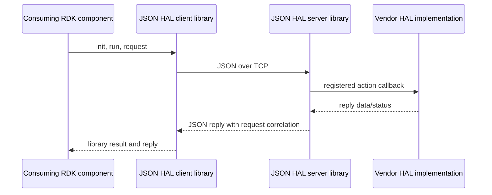

# JSON HAL Library Specification

## Version History

| Date | Comment | Version |
| --- | --- | --- |
| — | Documentation alignment; runtime unchanged. | — |

## Acronyms
HAL means Hardware Abstraction Layer; JSON means JavaScript Object Notation; TCP means Transmission Control Protocol; IPC means Interprocess Communication.

## Description
The library connects a consuming RDK component to a vendor HAL server using JSON messages over IPv4 TCP. RdkGponManager, RdkXdslManager, and Telco Voice Manager supply their respective product schema contracts; the library is shared transport, not a product schema owner. See the [detailed API and protocol reference](halSpecDetailed.md).

## Optional Components
`JSON_BLOCKING_SUBSCRIBE_EVENT` enables additional notification modes. Product schemas define their own permitted actions and parameter paths.

## Component Runtime Execution Requirements
### Initialization and Startup
Client: `json_hal_client_init`, `json_hal_client_run`, then check connectivity before sending requests. Server: `json_hal_server_init`, register application action callbacks, then `json_hal_server_run`. Terminate the owning side when complete.
### Threading Model
Socket work uses detached threads and shared global state. This is not an independently instantiated client/server context API. Do not assume arbitrary concurrent request or teardown calls are safe.
### Process Model
The supplied server binds IPv4 loopback using the configured port. Managers and vendor servers are separate processes; configuration/schema agreement is required.
### Memory Model
Manage JSON objects using json-c reference-counting rules. Helpers modify supplied objects without taking ownership of parameter structures. Confirm reply-object cleanup with the integration and copy callback data needed after callback execution.
### Asynchronous Notification Model
Subscribe with a callback, event name, and notification type. Publishing is server-to-client. Callback execution occurs through the library's receive path; avoid long-running callback work.
### Blocking Calls
`json_hal_client_send_and_get_reply` and its explicit-timeout variant block waiting for a reply or timeout. The explicit timeout is in seconds. Do not assume a timed-out hardware operation was cancelled.
### Internal Error Handling
Library status and wire `Result.Status` are separate results. Check both. Validator parsing/validation exceptions are not universally caught; malformed JSON is not guaranteed to become a C error return.
### Persistence Model
The library loads configuration/schema files. It does not supply product configuration durability, transactionality, or rollback.

## Nonfunctional Requirements
### Logging and Debugging
Implementations must not log credentials, secrets, security-sensitive information, or other sensitive data. Sanitize validator diagnostics as well as application logs.
### Quality Control
Use warning-clean builds, static analysis, memory checking, schema preflight, and fragmented/coalesced TCP tests. Known framing limitations must not be interpreted as reliable message boundaries.
### Licensing
See repository Apache-2.0 notices.
### Build Requirements
Build with CMake, json-c, and the nlohmann JSON/schema-validator C++ integration.
### Variability Management
Keep schema choice, configuration, linked library revision, and conditional notification modes consistent.

## Interface API Documentation
The detailed reference and source headers describe signatures, arguments, and return contracts.

| Area | Public APIs |
| --- | --- |
| Client lifecycle | `json_hal_client_init`, `json_hal_client_run`, `json_hal_client_terminate`, `json_hal_is_client_connected` |
| Requests | `json_hal_client_get_request_header`, `json_hal_client_send_and_get_reply`, `json_hal_client_send_and_get_reply_with_timeout` |
| Events | `json_hal_client_subscribe_event`, callback type `event_callback` |
| Reply inspection | `json_hal_get_result_status`, `json_hal_get_total_param_count` |
| Server lifecycle | `json_hal_server_init`, `json_hal_server_run`, `json_hal_server_terminate` |
| Server dispatch/events | `json_hal_server_register_action_callback`, callback type `action_callback`, `json_hal_server_publish_event` |
| Server helpers | `json_hal_get_subscribe_event_request`, `json_hal_add_schema_response`, `json_hal_add_result_status` |
| Common helpers | `json_hal_get_param`, `json_hal_add_param`, `json_hal_load_config` |
| Validator | `json_validator_init`, `json_validator_validate_request`, `json_validator_terminate` |

### Theory of Operation and Key Concepts
Messages contain `module`, `version`, `action`, and string `reqId`. Product schemas add action-dependent payloads. A successful library send does not prove a successful hardware operation.

### Sequence Diagram

## Source References
- [Client header](https://github.com/rdkcentral/json-hal-library/blob/develop/json_hal_client.h)
- [Client implementation](https://github.com/rdkcentral/json-hal-library/blob/develop/json_hal_client.c)
- [Server header](https://github.com/rdkcentral/json-hal-library/blob/develop/json_hal_server.h)
- [Server implementation](https://github.com/rdkcentral/json-hal-library/blob/develop/json_hal_server.c)
- [Common header](https://github.com/rdkcentral/json-hal-library/blob/develop/json_hal_common.h)
- [Common implementation](https://github.com/rdkcentral/json-hal-library/blob/develop/json_hal_common.c)
- [TCP client](https://github.com/rdkcentral/json-hal-library/blob/develop/tcp_client.c)
- [TCP server](https://github.com/rdkcentral/json-hal-library/blob/develop/tcp_server.c)
- [Validator header](https://github.com/rdkcentral/json-hal-library/blob/develop/json-schema-validator-wrapper/json_schema_validator_wrapper.h)
- [Validator implementation](https://github.com/rdkcentral/json-hal-library/blob/develop/json-schema-validator-wrapper/json_schema_validator_wrapper.cpp)
- [CMake configuration](https://github.com/rdkcentral/json-hal-library/blob/develop/CMakeLists.txt)
- [Validator CMake configuration](https://github.com/rdkcentral/json-hal-library/blob/develop/json-schema-validator-wrapper/CMakeLists.txt)
